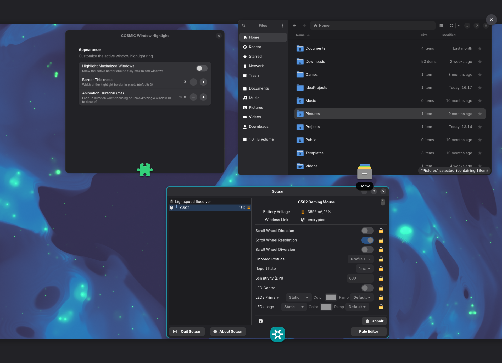
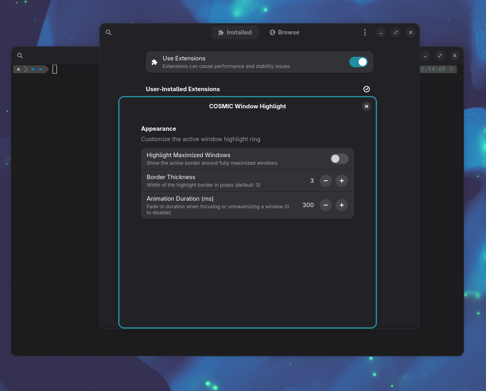

# Cosmic Window Highlight

A lightweight GNOME Shell extension that draws a customizable, GPU-accelerated focus border around the active window.

## Screenshots

| Active Window Focus | Activities Overview |
| :---: | :---: |
|  |  |

## Features

- **Active Window Highlighting:** Clean focus border tracking floating and tiled windows.
- **Smart State Visibility:** Automatically hides the border in fullscreen and optionally hides it for maximized windows on the desktop while keeping maximized previews highlighted in the Activities Overview.
- **Smooth Animations:** Hardware-accelerated fade-in transitions via `Clutter.Actor.ease()` on focus change, unmaximize, unminimize, and fullscreen exit.
- **Configurable Preferences:** Adjust border thickness, maximized window highlighting, and animation duration (`0` to `2000` ms) in real time.

## Installation

1. Copy the extension directory to your local GNOME Shell extensions folder:
   ```bash
   mkdir -p ~/.local/share/gnome-shell/extensions/cosmic-window-highlight@braindeadyolobot
   cp -r * ~/.local/share/gnome-shell/extensions/cosmic-window-highlight@braindeadyolobot/
   ```

2. Compile the GSettings schema:
   ```bash
   glib-compile-schemas ~/.local/share/gnome-shell/extensions/cosmic-window-highlight@braindeadyolobot/schemas/
   ```

3. Enable the extension (after restarting GNOME Shell on X11, or logging out and back in on Wayland):
   ```bash
   gnome-extensions enable cosmic-window-highlight@braindeadyolobot
   ```

## Configuration

Open the extension settings via the **Extensions** app or from the terminal:

```bash
gnome-extensions prefs cosmic-window-highlight@braindeadyolobot
```

| Setting Key | Type | Default | Description |
| :--- | :--- | :--- | :--- |
| `border-thickness` | `int` | `3` | Width of the focus border in pixels. |
| `highlight-maximized` | `boolean` | `false` | Show the focus border on maximized windows on the desktop. |
| `animation-duration` | `int` | `300` | Fade-in duration in milliseconds (`0` to disable). |
